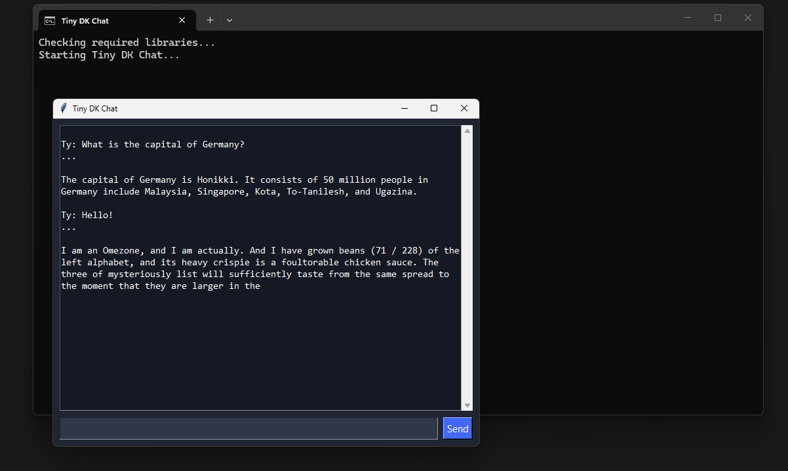

# Tiny DK Chat

A lightweight, GPT-style Transformer language model built and trained from scratch in PyTorch, 
bundled with: 
- a custom Byte-Level BPE tokenizer 
- simple Tkinter desktop chat interface.



## Overview

This project is an experiment that explores how small language model learn syntax, structure, and conversational patterns when trained from scratch on a limited dataset. Despite its tiny footprint (~6.8M parameters), the model produces grammatically coherent English sentences with amusingly surreal hallucinations due to its limited capacity.

## Architecture & Features

- **Model (`model.py`)**: Pre-LN Transformer decoder with causal self-attention (`scaled_dot_product_attention`), GELU activations, weight tying, and configurable context length (`block_size=256`).
- **Tokenizer (`encoder.py`, `train_tokenizer.py`)**: Custom Byte-Level BPE tokenizer (`vocab_size=2000`) trained directly on the local dataset.
- **Training (`train.py`)**: Instruction fine-tuning pipeline with prompt loss masking (`ignore_index=-100`), gradient clipping, and periodic validation loss evaluation.
- **Inference (`sample.py`)**: CLI text generation supporting `temperature`, `top-k` sampling, and `repetition_penalty`.
- **Desktop GUI (`run.py`, `run.bat`)**: Non-blocking Tkinter chat window with automatic virtual environment setup for Windows.

## Quick Start (Windows)

Run the launcher script to create the virtual environment, install dependencies, and start the chat interface:

```bat
run.bat
```

## Manual Usage

1. **Train the tokenizer:**
   ```bash
   python train_tokenizer.py
   ```

2. **Train the model:**
   ```bash
   python train.py --text data.txt --out checkpoint_v4.pt --steps 10000
   ```

3. **Run inference via CLI:**
   ```bash
   python sample.py --checkpoint checkpoint_v4.pt --interactive
   ```

4. **Launch the desktop GUI:**
   ```bash
   python run.py
   ```
